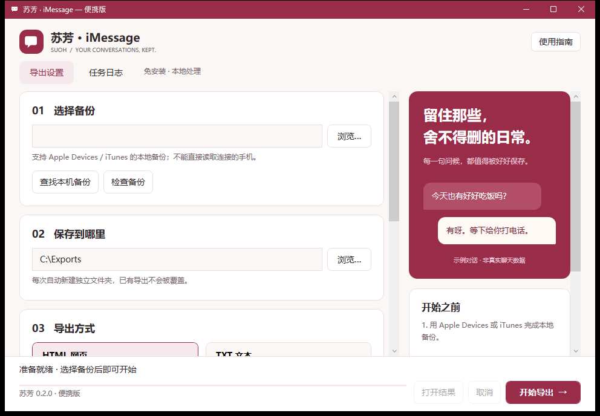

# 苏芳 · iMessage 0.2.0

基于 **ReagentX/imessage-exporter 原始 Rust 导出引擎**，从零编写的独立 Windows 图形应用。
此目录不引用、不编译旧版 `src/`、`tests/` 或旧版封装项目；使用新的 C# / WPF / .NET 10 项目。

## 使用

1. 将 `Suoh-0.2.0-Windows-x64-Portable.zip` 完整解压到可写文件夹。
2. 双击 **Suoh.exe**。保留旁边的 `engine` 和 `licenses` 文件夹，无需安装 .NET。
3. 选择 iPhone 本地备份根目录（含 `Manifest.plist` 和 `Manifest.db`）。也可以“查找本机备份”。
4. 选择导出位置、HTML / TXT 和附件方式，点击“开始导出”。每次自动创建新目录，不覆盖已有导出。

Windows x64 应用，面向 Windows 11（也可在符合 .NET 10 要求的 Windows 10 x64 环境运行；旧版 Windows 不支持）。
这是无代码签名的社区程序，系统可能显示信誉提示。仅从本仓库下载，并用 `SHA256SUMS.txt` 核对文件；不需要关闭安全软件。
便携版是一个完整文件夹，不是把引擎嵌入的单独 EXE。无需管理员权限，不写入安装信息或注册表。

## 新界面和窗口

- 苏芳主色 `#992C49`，取自提供的色卡，搭配暖白背景。
- 保留 Windows 原生标题栏、拖动、最大化、最小化、关闭和窗口贴靠。
- 每次启动在**鼠标所在显示器的可用区域**居中；先限高限宽再定位，不恢复旧窗口坐标。
- `PerMonitorV2`：Windows 缩放改变时，WPF 使用新 DPI 重新布局文字和控件。
- 监听 DPI、显示器、工作区变化；处理完系统缩放后，再以物理像素限制窗口边界，避免标题栏越界。
- 窄窗口隐藏右侧示例，矮窗口收起大标题，表单可滚动，操作区固定。
- `Ctrl+0` 重新居中，`Ctrl+L` 打开任务日志。

## 备份与附件

先使用 Apple Devices / iTunes 完成本地备份。软件不能直接连接手机，也不下载 iCloud 数据；备份中不存在的消息或媒体无法恢复。
加密备份请填写**本地备份密码**，不是 Apple ID 密码。

“保留原文件”不需要转换工具。HEIC 等格式是否能直接查看取决于查看器。
图片转换需要 ImageMagick；完整媒体转换另需 FFmpeg。可将工具和完整依赖放在程序旁 `tools` 目录，或使用已有 PATH；便携包不包含这些第三方转换工具。
日期范围为“开始当天及以后 / 结束当天之前”。输出内容与格式由原项目引擎生成；界面中的示例气泡不是导出模板。

## 隐私与便携

- 所有导出操作在本机完成，本应用无聊天数据上传、遥测或自动更新功能。
- 密码通过子进程环境传递，不写入命令行、偏好设置或日志；拥有本机调试权限的程序仍可能访问进程内存/环境。
- 仅勾选“记住目录和导出格式”才保存到程序旁 `data/preferences.json`，不存储密码、联系人筛选或窗口坐标。取消勾选会移除此设置文件。
- 不自动保存日志。手动保存的日志可能包含联系人和路径，请检查后再分享。界面保留最近 3000 行。
- .NET 自包含运行时可能解压运行缓存。加密备份使用每任务独立的系统临时目录，正常结束/取消时尝试清理；崩溃、断电或文件占用可能留下临时内容。
- 取消后保留已产生的部分结果，避免误删；它们不代表完整导出。

## 验证范围

自动测试覆盖 420 组分辨率 / DPI / 多屏负坐标 / 任务栏位置组合，导出参数、路径保护、目录链接和便携设置。
Windows CI 启动真实 WPF 窗口，验证实际 DPI 感知模式、原生窗口位置、离屏恢复及四种逻辑尺寸的布局，并生成截图。
CI 的逻辑尺寸检查不等同于在真实多显示器上切换 Windows 缩放，也不能替代使用真实 iPhone 备份的完整验收。
引擎额外进行运行库依赖检查和上游测试库的 HTML/TXT 导出检查；原项目测试中的 Windows 环境差异及一项 POSIX 路径断言排除，详见源码包的 BUILD.md。

## 来源

原项目：https://github.com/ReagentX/imessage-exporter

固定引擎提交：`4d90fc8d20a745c0a8acc1e01c0631c4bab89cb4`。
仅应用 `patches/suoh-password.patch`，让图形界面通过环境变量传入密码并避免隐藏的终端提示。
授权 GPL-3.0-or-later；对应源码和构建说明随同版本发布。此项目不是 Apple 或原项目作者的官方桌面应用。
